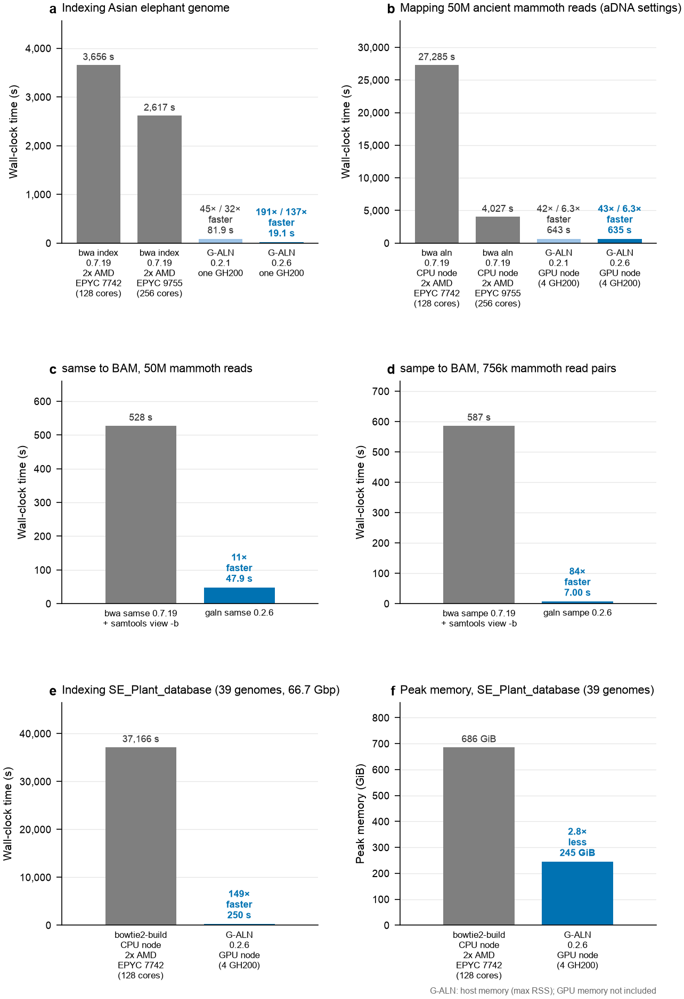

# G-ALN

G-ALN runs `bwa aln/index` on NVIDIA GPUs. The output files are byte-identical to that of BWA 0.7.19.




Benchmarks of G-ALN 0.2.6 (dark blue) compared with the preprint version 0.2.1 (light blue),
BWA 0.7.19 and bowtie2-build (grey); all output files are identical to those of BWA. e–f: indexing SE_Plant_database
(39 genomes, 66.7 Gbp) on a GPU node (4 GH200) and with bowtie2-build on a CPU node: wall-clock time (e) and peak
memory (f; for G-ALN, peak host memory, not counting GPU memory).

## Requirements

- An NVIDIA GPU of compute capability 7.0 or newer (tested on NVIDIA GH200)
- CUDA toolkit 11.8 or newer
- CMake 3.18 or newer and a C/C++ compiler with OpenMP (e.g. GCC)

## Install

```
git clone https://github.com/bilalbioinfo/galn.git
cd galn
cmake -S . -B build -DCMAKE_BUILD_TYPE=Release
cmake --build build -j 8
```

The program is `build/galn`.

## Run

1. Index the reference:

```
galn index -p ref ref.fa
```

`galn index` uses the fastest GPU builder that fits in GPU memory; `-a` chooses one (run `galn index` to see the
options). The largest reference tested so far is 66.7 Gbp, on a node with four GH200s.

2. Map the reads (example for aDNA reads):

```
galn aln -l 1024 -n 0.01 -o 2 ref reads.fq.gz > reads.sai
```

3. Make BAM (unsorted):

```
galn samse -f reads.bam ref reads.sai reads.fq.gz
```

For paired-end reads, map both files with `galn aln`, then:

```
galn sampe -f pairs.bam ref reads_1.sai reads_2.sai reads_1.fq.gz reads_2.fq.gz
```

`galn samse/sampe` run `bwa samse/sampe` on the CPU cores of the GPU node and write BAM directly, with the same
alignments as BWA. `galn samse/sampe` take the same options as `bwa samse/sampe`; add `--sam` to write SAM instead of BAM.

All `bwa aln` options have the same meaning and defaults as in BWA 0.7.19 (not supported yet: `-q`, BAM input).
Run `galn aln` without arguments to see all options, including `--gpus`, `--cpu-only` and `--gpu-only`.

## Checking byte-identical output (optional)

This is only needed if you want to confirm that G-ALN gives byte-identical files to `bwa aln`.
`bwa aln` writes its `-t` value (number of threads) into the header of the `.sai` file.
`galn aln -dt` (dummy threads) sets this header value; it does not change how many threads G-ALN uses.
G-ALN always uses all GPUs and internal CPUs cores given to the job.
Give `galn aln -dt` the same value as `bwa aln -t`:

```
bwa  aln -t 16  -l 1024 -n 0.01 -o 2 ref reads.fq.gz > bwa.sai
galn aln -dt 16 -l 1024 -n 0.01 -o 2 ref reads.fq.gz > galn.sai
md5sum bwa.sai galn.sai
```

## Changelog

Changes between versions are listed in [CHANGELOG.md](CHANGELOG.md).

## Citation

If you use G-ALN, please cite:

Sharif B., Hedfors K., van der Valk T., Heintzman P.D. and Dalén L. (2026) G-ALN: a GPU-accelerated BWA-aln
algorithm for palaeogenomics. *bioRxiv*. https://doi.org/10.64898/2026.10.18.759956

G-ALN is adapted from the BWA source code, so please also cite BWA:

Li H. and Durbin R. (2009) Fast and accurate short read alignment with Burrows-Wheeler transform.
*Bioinformatics*, 25, 1754-1760.
